# Proposed Implementation Dependency DAG

This is a work decomposition, not an adopted implementation architecture. It
adds nothing to the approved implementation specification. Root coordinates in
the existing BorgBuilder chat; workers may edit only assigned disjoint files.
The approved deployment and execution choices remain dedicated one-tenant
hosts/stores and direct execution. Two tenants in tests are synthetic fixtures.

The DAG-driven development process itself is now directly approved and recorded
in `spec/implementation.md`. This does not approve this graph's node designs.
The [machine-readable companion](implementation-dependency-dag.json) associates
the manually authored nodes with exact file/section/sentence identities from
the pinned original specification. All references and prerequisite edges are
checked; this is not a uniquely determined graph extracted from the spec.

## Derivation And Representation Reconciliation

This DAG is coordinator-authored engineering decomposition. Requirement
extraction and identity validation are repeatable checks; they do not choose
node groupings, file ownership, or dependency edges. Another valid implementation
could have a different DAG. No generator has been added and neither the original
specification nor the approved implementation specification changes here.

The previous representation had 18 nodes, 30 associations covering 29 distinct
requirements, and 44 JSON prerequisite edges but 42 diagram edges. Review retained
the two omitted edges deliberately: A to M because the proposed loop consumes
persisted attempt/lease/configuration state; API to DR because whole-platform
drain exercises frontend refusal and emergency admission. Both are sequencing
inferences, not source sentences that prescribe these node names. Store-level
backup/restore qualification does not depend on API. The revised diagram below
and JSON now enumerate the same proposed prerequisites.

## Current Boundary

F is complete only as an in-memory foundation: explicit clock/entropy, atomic
transactions and chosen-commit faults, immutable snapshots, generation fences,
and a bounded opaque session transition experiment. Existing code is in
`/home/dev-user/borg-runtime/components/borg-sim/src/{time,store,session}.rs`.
There is no production store, authentication, cryptography, model/tool loop, or
real dependency probe. The graph below does not assume an unapproved library.

```mermaid
flowchart TD
  subgraph Sim[Independently implementable simulator branches]
    F[In-memory foundations]
    A[Attempts and lifecycle]
    T0[Timer calculation]
    R[Receipts]
    D0[Authority fixtures]
    E0[Topic fan-out]
    B0[Blob ownership fixtures]
    H[Hooks]
    T[Timer delivery]
    E1[Canonical topic delivery]
    E[Governed ingress and caps]
    O[Usage]
    X[Transcript freeze]
    C[Dispatch]
    M[Direct loop]
  end
  subgraph Storage[Foundational real durability]
    P[Pending operator and material choices]
    DS[Commit recovery and fault contract]
    DA[Actual self-durable adapter]
    DV[Real probe parity and durability qualification]
    SF[Client sealing and compatible formats]
    SR[Stage resources that outlive clusters]
  end
  subgraph Real[Production bindings - each needs its simulator plus DV SF SR]
    A_live[Session and attempt state]
    R_live[Durable receipts]
    D_live[Authority and configuration]
    E_live[Topics inboxes and cursors]
    B_live[Blobs owners and pins]
    H_live[Decisions and transitions]
    T_live[Timer state]
    O_live[Usage and audit state]
    X_live[Transcript and frozen ranges]
    C_live[Dispatch state]
    M_live[Direct-loop state]
  end
  API[Authenticated production API]
  DR[Whole-platform drain restore and drills]
  F --> A
  F --> T0
  F --> R
  F --> D0
  F --> E0
  F --> B0
  A --> H
  D0 --> H
  A --> T
  T0 --> T
  E0 --> E1
  A --> E1
  H --> E1
  E1 --> E
  H --> E
  C --> E
  A --> O
  H --> O
  R --> O
  A --> X
  B0 --> X
  H --> X
  A --> C
  R --> C
  D0 --> C
  H --> C
  T --> C
  O --> C
  A --> M
  H --> M
  C --> M
  X --> M
  O --> M
  F --> DS
  DS --> DA
  P --> DA
  DS --> DV
  DA --> DV
  P --> SF
  P --> SR
  A --> A_live
  DV --> A_live
  SF --> A_live
  SR --> A_live
  R --> R_live
  DV --> R_live
  SF --> R_live
  SR --> R_live
  D0 --> D_live
  DV --> D_live
  SF --> D_live
  SR --> D_live
  E --> E_live
  DV --> E_live
  SF --> E_live
  SR --> E_live
  B0 --> B_live
  DV --> B_live
  SF --> B_live
  SR --> B_live
  H --> H_live
  DV --> H_live
  SF --> H_live
  SR --> H_live
  T --> T_live
  DV --> T_live
  SF --> T_live
  SR --> T_live
  O --> O_live
  DV --> O_live
  SF --> O_live
  SR --> O_live
  X --> X_live
  DV --> X_live
  SF --> X_live
  SR --> X_live
  C --> C_live
  DV --> C_live
  SF --> C_live
  SR --> C_live
  M --> M_live
  DV --> M_live
  SF --> M_live
  SR --> M_live
  A_live --> API
  H_live --> API
  R_live --> API
  DV --> API
  SF --> API
  SR --> API
  A_live --> DR
  R_live --> DR
  D_live --> DR
  E_live --> DR
  B_live --> DR
  H_live --> DR
  T_live --> DR
  O_live --> DR
  X_live --> DR
  C_live --> DR
  M_live --> DR
  API --> DR
  DV --> DR
  SF --> DR
  SR --> DR
```

## Where Durability Lands

Durability is foundational to production state, not a feature first added at
DR. `F` is only a logical in-memory substrate. Moving a `SimStore` into a new
kernel reconstructs resident state while retaining the same in-memory store;
it proves neither process restart nor node-loss nor full-cluster durability.

| Lane | Dependency and scope | Current state |
|---|---|---|
| DS | Extend F's commit/recovery contract and explicit fault scenarios; original durability obligations govern this work already | Atomic snapshots/fences/chosen transaction faults modeled; persistent I/O/loss model and full fault repertoire missing |
| DA | DS plus P's concrete store/test-substrate choice: actual self-durable WAL, snapshot/index, committed-state survival, store backup/restore | No real durable adapter, persistent WAL/index/snapshot or approved store |
| DV | DS and DA: identical simulator/real-probe expectations plus crash/all-node-loss/backup-recovery evidence | No real probe parity or physical durability evidence |
| SF | Separate crypto/key/irreversible-format decisions: seal before store writes; maintain tagged compatible formats | No encryption or compatible production format; fixture codecs are disposable |
| SR | Stage-owned blob, key, signing, restore-source and stable-name resources that survive cluster replacement | Not selected or provisioned; this proposal authorizes neither |
| *_live | Each corresponding simulator branch plus DV, SF and SR | Explicit missing production bindings; these edges do not block the simulator branch |
| DR | All production state domains and API, using the qualified substrate | Whole-platform ordered drain, conditional epoch takeover, authority/emergency-first restore, identity/dedupe preservation and release drills missing |

The *_live nodes distinguish concrete persistence paths: A sessions/attempts/
controls; R receipts; D authority/configuration; E topic/subscription/inbox
progress; B blobs/owners/pins; H decisions and transitions; T timers; O usage and
audit progress; X transcript/frozen ranges; C dispatches; M direct-loop state.
They are qualification/binding tasks, not eleven new stores or approval of a
production architecture. DA/DV can run alongside remaining simulator work once
their material choice is settled. SF can proceed independently of the store
adapter; real tenant writes wait for all required gates.

### Exact Original Source Binding

The JSON keeps every quoted sentence as an original file/section/sentence
identity, including the following foundations and downstream obligations:

| Original source and stable section | Required guarantee |
|---|---|
| [constitution.md, P5](../constitution.md#p5-durable-state-disposable-memory) | Every part of session state is durable; node memory is a disposable cache rebuildable at any moment |
| [shared-framework, Durable Store Durability](../spec/core/shared-framework.md#durable-store-durability) | Durable snapshot/index/log; full-cluster restart survival; defined store backup/restore |
| [self-durable, The Store Survives The Loss Of Every Node](../spec/decisions/durability/self-durable.md#the-store-survives-the-loss-of-every-node) | Every-node loss loses no committed state; the store's own WAL/snapshot/index is the mechanism |
| [self-durable, A Crash Loses No Committed State](../spec/decisions/durability/self-durable.md#a-crash-loses-no-committed-state) | A crash loses no committed state |
| [simulation-and-conformance, Every Dependency Has A Verified Simulator](../spec/core/simulation-and-conformance.md#every-dependency-has-a-verified-simulator) | Same expectations through real probes; divergence fails; latency/tails, throttles, errors, timeouts, disconnects, duplicates, reordering, partial failures and a chosen transaction failure |
| [stored-form, Scheduling Fields Are Readable Without Keys](../spec/contracts/stored-form.md#scheduling-fields-are-readable-without-keys) | Writing client seals tenant content before storage; only enumerated operational metadata is unencrypted |
| [stored-form, Every Durable Format Is Self-Describing](../spec/contracts/stored-form.md#every-durable-format-is-self-describing) | Tagged fields, unknown-field preservation, old records remain readable, consecutive rollout forms coexist |
| [durability-and-deployment, Stage Resources Outlive Every Cluster](../spec/core/durability-and-deployment.md#stage-resources-outlive-every-cluster) | Blob/key/signing/restore/name resources survive cluster loss/replacement |
| [durability-and-deployment, The Epoch Fence](../spec/core/durability-and-deployment.md#the-epoch-fence) | Conditional epoch increment and every write conditioned on epoch; superseded clusters cannot continue writing |
| [durability-and-deployment, A Drain Is Orderly](../spec/core/durability-and-deployment.md#a-drain-is-orderly) | Apply pending work, freeze, preserve emergency controls and write final records before storage terminates |
| [durability-and-deployment, A Restore Resumes Every Session](../spec/core/durability-and-deployment.md#a-restore-resumes-every-session) | All records written before partitions start; authority/emergency controls precede resume; tenant restored whole; IDs and request dedupe survive |
| [durability-and-deployment, Restores Are Drilled](../spec/core/durability-and-deployment.md#restores-are-drilled) and [self-durable restart drill](../spec/decisions/durability/self-durable.md#a-full-cluster-restart-is-drilled) | Every-release preproduction restore/restart drills; restore into a different failure domain |

### Commit And Fault Evidence To Establish

DS/DA/DV must distinguish a definite precommit failure from an unknown outcome
after apply, prevent partial multi-key state/cursor/receipt publication, enforce
fences at commit, and reread committed state before redo. Those logical cases
already have limited F/A/R tests. A real durable qualification additionally
restarts actual processes, loses the relevant nodes, and rebuilds from surviving
store-owned persistence/backup while checking that committed state is retained.
The same scenario expectations must fail on a divergent real probe. Reordered,
duplicated, dropped and delayed operations and partial failures are tested at
the actual dependency boundary as applicable, rather than inferred from an
in-memory object reconstruction.

The crash-point matrix must follow the chosen store's real commit/recovery
boundary: work not acknowledged as committed may require an unknown-outcome
reread; acknowledged committed state cannot be silently lost or rolled back.
WAL/snapshot/index failures and recovery validation must be exercised. These are
required guarantees and test obligations, not a selected fsync schedule, quorum,
replica count, replication algorithm or disk/cache-flush policy. A local file or
periodic checkpoint alone is not evidence for all-node-loss survival.

### Smallest Future Operator Choice

No choice is needed to establish that durability is required, and no choice
blocks the simulator lanes. Before DA writes a real adapter, the smallest
concrete decision is the store candidate plus the permitted persistent test
substrate/failure boundary: what storage survives loss/replacement of all compute
nodes, and where process/node/backup-recovery probes may run. This task does not
authorize provisioning that environment.

Recommendation at that boundary: evaluate an existing self-durable transactional
store and its supported persistent substrate against DS before committing to
building a store. Alternative: build/own the store implementation and its WAL,
snapshot/index, backup and recovery mechanism, with the additional implementation
and evidence burden. A local-disk prototype with synthetic data can explore an
adapter, but is not a third conformant production outcome. Sealing/key handling
and irreversible durable format choices remain separate prerequisites.

[record.md, Durable substrate](../spec/record.md#durable-substrate) specifies a
category, not a vendor. Self-durable is already the active fixed default. The
[external recovery-store alternative](../spec/decisions/deferred.md#a-recovery-store-outside-the-cluster)
is reopened only by its stated survival/loss/restore-time trigger, not because
this initial simulator stores its state in memory. No RPO loss window, provider,
store, runtime, filesystem policy, credentials or recovery-store alternative is
adopted by this proposal correction.

## Execution Status And Ownership

The first independent T0 calculation branch is complete in the simulator.
A, R, D0, E0, B0, bounded H, one-shot T and usage-ledger O are implemented
and tested as fixtures. This does not complete their full normative scope.
Checkpoint `run-f_xq170m` passed 167 runtime tests and 2 compile-fail API tests,
formatting, Clippy and 33 Python tests. Actual Duvet reports 118/1,817 paired links,
1,699 missing implementation and 1,699 missing test links. All 107 reviewed completed
requirements have local line-execution witnesses; 31 partial, 12 concretely
unimplemented and the unassessed requirements remain nonconformant/unresolved.

C has been released to session_model_tests and E1 to kernel_review. E1 separates
the ready canonical delivery bridge from full E's C-dependent held-answer/cap
rules, so parallel work honors the actual prerequisite interfaces. Root retains
all shared session schema/exports/codec integration.

| Node | Actual owner and isolated files | Delivered scope / remaining edge |
|---|---|---|
| A | Coordinator: session schema, `src/session/processing.rs`; session_model_tests: `tests/processing_model.rs` | Persisted attempts, failure counters and control receipts; full lifecycle/backoff absent |
| R | kernel_review: `src/receipts.rs`, `tests/receipts.rs` | Receiver admission/settle/close/reconcile; real effects and sender cutoff absent |
| D0 | session_model_tests: `src/authority.rs`, `tests/authority.rs` | Narrowing grant chains and loaded-tool fixtures; authentication and actual dispatch absent |
| E0 | session_model_tests after D0: `src/topics.rs`, `tests/topics.rs` | Bounded atomic fan-out into fixture queues; SessionKernel and admission integration absent |
| B0 | blob_ownership: `src/blob_ownership.rs`, `tests/blob_ownership.rs` | Owner/pin/reclaim protocol; actual encryption/key destruction absent |
| H | kernel_review: `src/hooks.rs`, `tests/hooks.rs`; coordinator: `src/session/governance.rs` and its tests | Ordered synthetic verdicts and fenced atomic notification decisions/state; full request/configuration governance absent |
| T | session_model_tests: `src/session/timers.rs`, `tests/session_timers.rs`; coordinator: shared schema and consume paths | Delivered: session-owned one-shot records, atomic firing, typed invalidation; recurring delivery and clock mapping still sequenced |

The existing BorgBuilder chat remains the sole coordinator. Shared exports,
Cargo files and session interfaces are coordinator-owned. Completed files freeze
before review/integration; later annotation-only ownership transfers are explicit.
The [runtime execution ledger](../../borg-runtime/docs/dag-progress.md) records
worker starts, tests and the remaining simulator boundaries. These are actual
assignments, not a list of proposed workers. The original specification's rule
against speculative universal abstractions remains binding.

## Why The Edges Exist

- **F to A:** [event failure handling](../spec/core/failure-handling.md#an-event-that-fails-repeatedly)
  commits attempt counts before execution and supplies retry/skip exits;
  [ownership fencing](../spec/core/sessions-and-partitions.md#ownership-is-fenced-by-generation)
  requires lease changes and postcommit resume acknowledgement. Completion must
  reject a token from before a resume, configuration reset, or owner move.
- **A and T0 to T:** [timer delivery](../spec/core/timers.md#a-fire-is-exactly-once)
  couples timer advance, inbox, and doorbell in one fenced commit and forbids
  firing into paused, blocked, or quarantined sessions. Pure arithmetic can run
  in parallel; timer delivery cannot precede lifecycle semantics.
- **F to R:** [tool-call contract](../spec/contracts/tool-call.md) distinguishes
  receipt lookup, new admission, settlement, close and reconcile, with different
  fencing rules. A simulated receiver can be built before a real executor.
- **A and D0 to H:** [pipeline order](../spec/core/governance.md#a-pipeline-runs-low-cost-deciders-first)
  and [decision commits](../spec/core/governance.md#every-decision-is-an-event)
  need immutable caller/configuration input, stable decision identity, and atomic
  decision/event/state writes. The [bootstrap exception](../spec/core/governance.md#two-paths-sit-outside-the-pipeline)
  breaks the apparent configuration/governance cycle; ordinary later changes
  still [pass a hook](../spec/core/governance.md#changing-configuration-passes-a-hook).
- **E0 and H to E:** [topic admission](../spec/core/events-and-subscriptions.md#a-topic-belongs-to-a-topic-group)
  needs governance; [bounded fan-out](../spec/core/events-and-subscriptions.md#publish-latency-is-independent-of-subscribers)
  needs atomic delivery batches. [Inbox-cap exceptions](../spec/core/sessions-and-partitions.md#a-pending-inbox-is-bounded)
  also depend on trusted open dispatch/defer records, not a payload claiming to
  answer held work.
- **Work identities to O:** [usage records](../spec/contracts/usage-record.md)
  are unique per attempt/call and have independent retention and a flush path.
  Add them alongside each real work identity; do not invent a second usage stream.
- **A, B0 and H to X:** [pins and ownership](../spec/core/encryption-and-blobs.md#sharing-is-an-explicit-pin)
  precede references and reclamation; [whole-session freeze](../spec/core/sessions-and-partitions.md#the-resident-form-is-a-cache)
  must reject a racing append and open work. Transformed/gated content determines
  which transcript bytes may be frozen.
- **A, R, D0, H, T and O to C:** [dispatch sequence](../spec/core/tools-and-dispatch.md#the-dispatch-sequence)
  resolves the loaded definition, passes hooks, commits dispatch, then sends.
  [Credential leasing](../spec/core/identity-delegation-and-secrets.md#secrets-stay-out-of-the-model-and-the-records)
  is per call and reaches only the executor. First implement synthetic dependencies,
  with no network or real credential path.
- **C, H, X and O to M:** [direct execution](../spec/decisions/execution/direct.md)
  owns streaming, interruption and per-block gates; [context/compaction](../spec/decisions/execution/direct-context-compaction-and-cache.md)
  needs stable transcript ranges and atomic swaps. Direct execution alone selects
  no Rust runtime or inference provider.
- **Verified authority, H, R and A to API:** [authenticated calls](../spec/core/the-frontend.md#a-principal-makes-every-call)
  and [request dedupe](../spec/core/the-frontend.md#a-request-that-changes-state-is-deduplicated)
  precede network admission. A fixture caller is not a verifier.
- **P and all durable subsystems to DR:** [epoch fencing](../spec/core/durability-and-deployment.md#the-epoch-fence)
  and [restore ordering](../spec/core/durability-and-deployment.md#a-restore-resumes-every-session)
  preserve identities, authority and controls before resuming sessions. The active
  outcome is [self-durable](../spec/decisions/durability/self-durable.md), not recovery-store.

## Decisions That Actually Block Production Work

Concrete store/transaction semantics, encryption/key-service realization,
durable encoding and partition hash, runtime/executor, and transport remain
material choices to review with Matthew before adoption. Bach/Bolero, event
generation and shared-buffer proposals remain unapproved. None blocks the ready
synthetic lanes. Calendar/time-zone implementation and production timer clock
mapping are outside T0. Deployments and listeners additionally need explicit
authorization and the corresponding security prerequisites.

## Integration And Evidence Gates

Each lane supplies exact requirement identities, enforcing code and discriminating
tests. Integration checks atomicity, generation/lease checks, tenant bounds,
transaction limits, and the absence of an alternate unfenced path. Fault scenarios
cover precommit failure, lost replies, reconstructed memory, stale owners,
duplicates, reordering and two tenants against independent reference models.

Run actual Duvet on the unchanged pinned selection, report its denominator and
implementation/test results, and retain exact-citation checks plus source-bound
test execution evidence. [Real dependency parity](../spec/core/simulation-and-conformance.md#every-dependency-has-a-verified-simulator)
is a later gate for each real adapter. Local reports, test counts and declaration
tags are not trusted execution evidence or permission to promote; the
[full requirement gate](../spec/core/simulation-and-conformance.md#the-gate-decides-promotion)
remains blocking.
